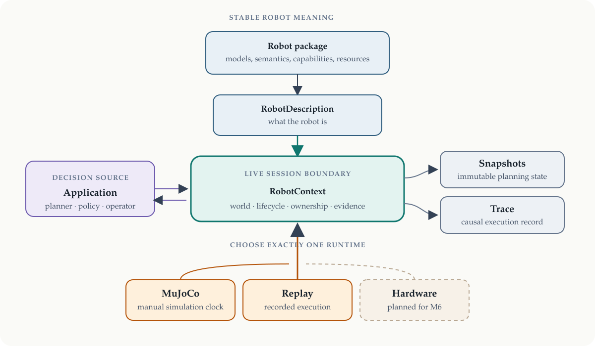
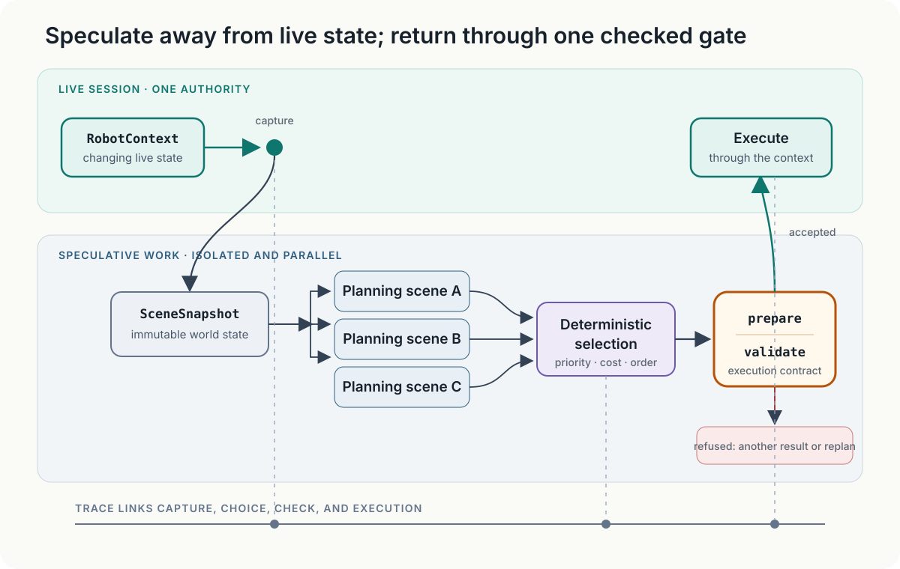

# ssrobot

A robot changes less often than the software that decides what it should do. The same
arm may be driven by a motion planner in simulation, a learned policy during an
experiment, and an operator during recovery. Those decision makers should not each
invent their own names for the robot, interpretation of its observations, or path to
execution.

ssrobot separates the stable meaning of a robot from the mechanism that runs it. It
lets decisions be made against immutable world states, then checks and records the
transition back to execution. A planner, policy, or operator can therefore share one
robot description, command boundary, and causal record without being coupled to one
another.

ssrobot is not a planner, simulator, policy framework, skill library, viewer, or robot
application. It is the small boundary those systems share.

## Describe the robot once

A [robot package](docs/authoring.md) keeps everything required to identify and use a
robot together: its mechanical model and assets, named groups and end effectors,
capabilities, observation channels, limits, configurations, and runtime profiles.
Loading it produces one immutable, validated `RobotDescription`.

MJCF and URDF remain the mechanical sources. ssrobot does not copy their geometry,
dynamics, or actuator models into a new format. Its manifest supplies the portable
meaning that neither format completely expresses: which joints form an arm or mobile
base, which frame is a tool center point, which commands are supported, which channels
can be observed, and which backend resources implement them. Runtimes continue to read
the original model files.

## A runtime executes; a context defines the session

A `Runtime` implements interaction with one execution system. It determines how time
advances, observations are obtained, commands are submitted and tracked, and the
connection is opened and closed. `MujocoRuntime` steps physics; `ReplayRuntime`
reproduces a declared execution. A physical runtime is planned for M6.

A `RobotContext` binds exactly one runtime to a robot description and a world. It owns
the session's lifecycle, command ownership, scene revision, snapshots, execution
boundary, and trace. Applications use contexts; backend integrations implement
runtimes.



*A robot description provides stable meaning, while a runtime provides a particular
execution mechanism. A context binds one of each into a live robot session.*

Moving between simulation, replay, and future hardware means constructing another
context with the same robot semantics and a different runtime. An existing context
does not silently change its backend, and runtimes need not claim capabilities they do
not provide.

## Plan away from live state; execute through it

Planning does not operate directly on changing live state. A context captures an
immutable `SceneSnapshot`; isolated planning scenes made from that snapshot can be
used by different planners, seeds, arms, or future stages without racing the live
robot. Because these scenes carry no clock or execution authority, planning can run in
parallel with other planning and, when its expected starting state is explicit, with
the current motion.

A plan is data and never moves the robot. Before execution, the context compiles it for
the runtime's declared trajectory contract and asks the planner's validator about the
command that will actually be run. A stale world, incompatible arrival, invalid
motion, or unavailable capability is refused before submission, with evidence rather
than a silent adjustment.



*Planning may branch freely from immutable state. Execution remains singular and is
entered through one checked boundary.*

This model supports ordinary planning, deterministic planner portfolios, races between
arms or goals, multi-stage candidates, and planning a continuation while the current
motion executes. [Planning](docs/planning.md) describes those mechanisms and the
conditions under which speculative work may return to the live context.

## Keep the causal record

With a trace attached, the robot and world identities, snapshot, planning request,
result, validation, prepared command, execution states, and observations remain linked.
A trace reads back strictly. A [run bundle](docs/traces.md) adds the exact robot, scene,
and array files needed to inspect that record after it is moved.

This record serves several uses without changing the execution path: diagnosing a
refusal, reproducing a run, comparing dependency versions, replaying recorded state,
or deriving learning data from planner-generated demonstrations. Simulator-only
observations are marked as privileged so a dataset can distinguish information a
physical robot could have supplied from information available only in simulation.

## Change who decides, not what execution means

A planner, learned policy, and human operator need not share one algorithmic interface.
They do share the context's declared observations, typed commands, ownership rules,
execution states, checked boundary, and trace. ssrobot owns that agreement. Task
sequencing, grasp strategy, policy architecture, and operator interfaces stay in the
packages that provide them.

Planning and MuJoCo execution are implemented today. Learned-policy execution is M4,
physical deployment is M6, and teleoperation is not yet scheduled; the common boundary
is not evidence that every decision source or runtime already exists.

## A complete planning example

From a clone, [uv](https://docs.astral.sh/uv/) installs the MuJoCo and planning
integrations used by the repository examples:

```sh
git clone https://github.com/personalrobotics/ssrobot
cd ssrobot
uv sync
```

This example loads a packaged robot, constructs one MuJoCo session, plans from a
snapshot, executes through the checked boundary, and reads the resulting trace:

```python
import ssrobot
from ssrobot.mujoco import MujocoRuntime
from ssrobot.planning import CBiRRT

package = ssrobot.load_package("examples/packages/mujoco_arm")
runtime = MujocoRuntime(package, scene="examples/scenes/pedestal.xml")
planner = CBiRRT(package.description)

with ssrobot.JsonlTrace("run/trace.jsonl") as trace, ssrobot.RobotContext(
    package.description, runtime, sinks=[trace]
) as ctx:
    arm = ctx.manipulator()
    snapshot = ctx.snapshot()
    plan = arm.plan_to_configuration(
        (-0.6, -0.4, 0.0),
        snapshot=snapshot,
        planner=planner,
        velocity_scaling=0.5,
    )
    execution = ctx.execute(plan, planner=planner)
    status = ctx.run_until(execution, max_ticks=5_000)
    print(status.state.value, plan.backend, round(plan.trajectory.duration, 2), "s")

records = ssrobot.read_trace("run/trace.jsonl")
print(len(records), "trace records:", sorted({record.kind.value for record in records}))
```

It prints `succeeded native 1.01 s` and the kinds of record the trace contains. Run it
with `uv run python` from the repository root. The installed-wheel CI job runs this
same example from the built distribution.

The runtime, context, manipulator, planner, snapshot, plan, and execution are explicit
because each names a decision that becomes part of the evidence. For compact code, a
`plan_to_*` call can capture its own snapshot; pass one explicitly when several plans
must describe exactly the same world. See [ordinary planning](docs/planning.md#ordinary-planning)
for the supported goals and execution choices.

## What works today

| Capability | Status | Details |
| --- | --- | --- |
| Portable robot packages from MJCF, URDF/SRDF, or ssrobot kinematics | Implemented; Geodude and ADA packages are checked in CI | [Authoring](docs/authoring.md) |
| MuJoCo execution, scenes, attachments, observations, snapshots, and guarded commands | Implemented | [MuJoCo](docs/mujoco.md) |
| Configuration, pose, offset, and TSR planning through sscbirrt, ssik, and sstsr | Implemented; exercised on Geodude and ADA | [Planning](docs/planning.md) |
| Planner portfolios, alternative requests, staged candidates, and interleaved planning and execution | Implemented; used by ssgrasping and Geodude | [Planning](docs/planning.md) |
| Versioned traces, portable run bundles, strict reading, and replay | Implemented | [Traces and replay](docs/traces.md) |
| Live visualization and bundle replay | Provided by [mj_viser](https://github.com/personalrobotics/mj_viser)'s optional ssrobot integration | mj_viser |
| Robot-neutral grasp, place, and drop skills | Provided by [ssgrasping](https://github.com/personalrobotics/ssgrasping), demonstrated on Geodude in MuJoCo | ssgrasping |
| Learned-policy execution | Planned for M4 | [Architecture](docs/architecture.md) |
| Physical hardware through ROS 2 | Planned for M6 | [Architecture](docs/architecture.md) |
| Teleoperation | Not scheduled | [Architecture](docs/architecture.md) |

MuJoCo is currently the only simulated runtime and sscbirrt the only planner adapter.
The neutral contracts make other integrations possible; they do not count as supported
until a complete reference application demonstrates them.

## How the ecosystem fits

| Layer | Owns |
| --- | --- |
| ssrobot | Robot semantics, runtimes, state, commands, observations, planning contracts, execution, and evidence |
| sscbirrt, ssik, sstsr | Planning, inverse kinematics, and constraint mathematics |
| ssgrasping | Robot-neutral manipulation skills |
| mj_viser, ssmjviser | General read-only MuJoCo visualization and its optional ssrobot integration |
| Geodude, ADA, Opendubs | Robot- and task-specific applications |
| sspilot (future) | Discoverable operator, CLI, and agent-facing interfaces |

Robot-specific behavior belongs in the robot's application. A skill that works across
robots belongs in ssgrasping. ssrobot holds only the semantics and execution boundary
that all of them must share.

## Read only what you need

| Task | Document |
| --- | --- |
| Bring up and distribute a robot | [Authoring a robot package](docs/authoring.md) |
| Understand the package format precisely | [Robot packages](docs/packages.md) |
| Simulate scenes, commands, observations, and attachments | [MuJoCo integration](docs/mujoco.md) |
| Plan, race alternatives, validate, and plan ahead | [Planning](docs/planning.md) |
| Record, bundle, inspect, and replay a run | [Traces and replay](docs/traces.md) |
| Implement a runtime or consume exact public records | [Contracts](docs/contracts.md) |
| Understand scope and dependency ownership | [Architecture and charter](docs/architecture.md) |

The detailed documents are specifications and operational guides. The README owns the
conceptual argument and does not repeat their complete interfaces.
