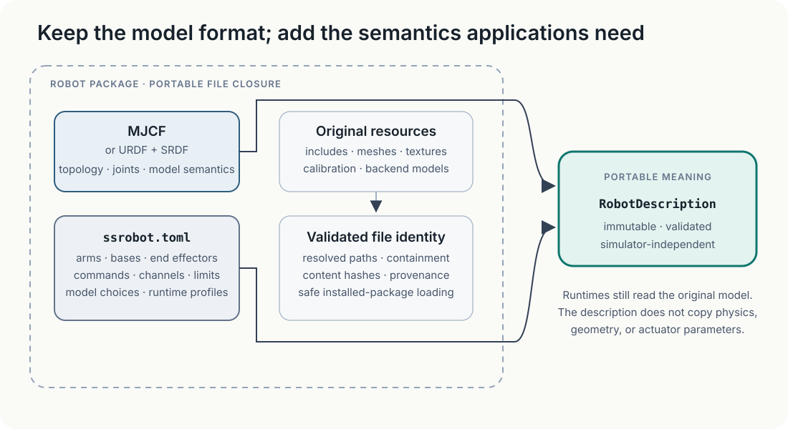

# Authoring a robot package

A robot package keeps the information needed to use a robot in one place. Its MJCF,
URDF, or SRDF remains the authority for the mechanical structure and backend model it
expresses, and runtimes continue to read those original files.

The manifest records the application-level semantics that these formats do not
represent uniformly: named manipulators and mobile bases, end effectors, command
capabilities, observation channels, limits, configurations, model choices, and runtime
profiles. Loading validates the manifest and model together and produces one immutable
`RobotDescription`.

<picture>
  <source media="(max-width: 600px)" srcset="figures/robot-package-narrow.svg">
  
</picture>

*The manifest complements the established model formats. It does not copy their
physics or geometry into another model.*

The package format itself is specified in [packages.md](packages.md). The shortest
path from a model file to an installed, inspectable package is:

```console
$ ssrobot init path/to/robot.xml --robot my_robot      # answer what structure can't decide
$ ssrobot inspect path/to/package                      # what was loaded
$ uv build && ssrobot doctor path/to/package --wheel dist/my_robot-*.whl
```

## Two worked references

[`scripts/author_reference_packages.py`](../scripts/author_reference_packages.py)
authors two reference packages from their mechanical models alone:
[`mujoco_arm`](../examples/packages/mujoco_arm) from MJCF, and
[`urdf_arm`](../tests/fixtures/packages/urdf_arm) from URDF with its SRDF. It answers
`init` from a recorded answers file, takes the reference manifest as the author's
finished version, checks the package with `doctor` and its wheel, and inspects it
installed by module name. CI runs it from the clean wheel:

```console
$ python scripts/author_reference_packages.py --out authoring
```

Each robot's `provenance.json` records which manifest entries `init` wrote from the
model, which fields the author changed, and which entries the author added:

- **From `init`, in both.** `init` writes the model entry, the manipulator, the gripper,
  and the end effector. For MJCF, which has no groups, it also writes the arm's group.
- **Changed by the author, in both.** The author moves the manipulator's tool frame
  from the last link `init` proposed to `flange`.
- **Added by the author to `mujoco_arm`.** Commands, channels, sensors, rate limits, two
  configurations, gripper calibration, a second group, a collision allowance, and the
  MuJoCo profile.
- **Added by the author to `urdf_arm`.** A trajectory command, a joint-position channel,
  a MuJoCo model, and its profile.

Frames, joints, and the URDF's limits stay in the model, as do the SRDF's groups and
collision allowances. None of them is copied into the manifest.

## `ssrobot init MODEL`

`init` writes an `ssrobot.toml` for an MJCF (`.xml`), URDF (`.urdf`, with a sibling
`.srdf` used automatically), or ssrobot kinematics (`.json`) model. It proceeds in
this order:

1. **Locate the package root.** It is the outermost Python package directory
   containing the model, so the manifest ships inside the installed package; otherwise
   it is the model's directory. Override it with `--package-root`.
2. **Load the model** through the same loaders as `load_package`, resolving every
   include and resource.
3. **Infer candidates** (arms, grippers, tool center points) from structure alone,
   with their evidence. See *Inference* in packages.md.
4. **Ask** only what structure cannot decide.
5. **Validate** the complete manifest by loading it in memory, then write it
   atomically, then reload it through the public API.

The written manifest is fully explicit, with no `[inference]` table, so its meaning
never changes with later inference rules. Rerunning with the same model and answers
leaves the file unchanged. A different existing manifest is never replaced without
`--force`. Even with `--force`, or `overwrite=True` through the API, a manifest is
validated against the package before the file is touched. A failure at any step leaves
the existing manifest and no temporary files.

### Decisions

| Decision | Default |
| --- | --- |
| `robot` | Required, unless `--robot` is given. |
| Each candidate, by its id (for example `chain:joint1..joint7`) | Included under `arm`, `gripper`, `end_effector`, or its SRDF group's name, when it is the only candidate of its kind and has no alternatives. Otherwise required: include it under a name, or leave it out. |
| `template:commands` | Off. When on, every manipulator group gets joint position and trajectory commands, and every gripper gets gripper commands. |
| `template:joint_channels` | Off. When on, every manipulator group gets a `<group>_q` joint-position channel, and every gripper a `<gripper>_opening` channel. |

Explicit authoring is not limited by inference's ambiguity sets. You may include both
an arm and the same arm with its lift as separate manipulators; they then share one end
effector. An SRDF group with the same joints as an included chain is reused, not
duplicated. Command capabilities, channels, controller modes, and hardware interfaces
are never inferred; the templates are the only way `init` adds them, and only on
request.

### Answers

On a terminal, `init` asks each open question, shows the manifest, and asks before
writing; `--yes` skips that last confirmation. Anywhere else it never prompts. If
decisions remain open, it lists them, writes the draft (an `ssrobot.AuthoringDraft`)
to `--draft-json`, and exits with status 2. Supply answers with
`--answers FILE`, either as an `ssrobot.AuthoringAnswers` JSON record or as TOML with
the same fields. A candidate may be answered only once, across `include` and `exclude`
together, and a template listed only once (`duplicate_name`).

```toml
robot = "bimanual_lift"
templates = ["commands", "joint_channels"]
exclude = []

[[include]]
candidate = "chain:left_shoulder_pan..left_wrist_3"
name = "left_arm"

[[include]]
candidate = "chain:left_lift..left_wrist_3"
name = "left_arm_with_lift"

[[end_effectors]]          # a TCP the model has no leaf frame for
name = "hand"
frame = "hand"
gripper = "gripper"
```

## `ssrobot inspect PACKAGE`

`inspect` prints a readable summary of a package directory or an installed package name.
The summary is not a compatibility surface. `--json PATH` writes the
`ssrobot.PackageReport`, which is.

## `ssrobot doctor PACKAGE`

`doctor` runs these checks:

| Check | Fails when |
| --- | --- |
| `manifest` | The package does not load, for any reason `load_package` rejects. |
| `resources` | (Passes whenever the package loads; it reports how many files resolved.) |
| `semantics` | Inference or an SRDF end effector left something ambiguous. |
| `capabilities` | (Reports the declared commands and channels.) |
| `wheel` | With `--wheel PATH`, the wheel lacks the package's `ssrobot.toml` or any file it needs, or loading it as an installed package gives a different description or file set. |

A failed check prints what to do next and the section that explains it.
`--json PATH` writes an `ssrobot.DoctorReport`, whose failed checks carry the refusal
`code` with its `why`, `next`, and `see`. `--check` writes nothing and cannot be
combined with `--json`. A wheel that cannot be read fails the `wheel` check with the
reason, rather than stopping `doctor`. That covers a missing file, a non-zip, or a
corrupt entry.

## Exit status

| Status | Meaning |
| --- | --- |
| 0 | Success. |
| 1 | An invalid model, package, or answer; a missing input or unwritable output file; or a failed check. Each prints a diagnostic, never a traceback. A refusal also prints why ssrobot will not choose, what to do next, and where it is documented; see [Refusals](packages.md#refusals). |
| 2 | Decisions still need answers and there is no terminal to ask. |
| 3 | A different manifest exists and `--force` was not given. |

## Editor support

Manifests are plain TOML, and [`schemas/ssrobot.package.v1.json`](../schemas/ssrobot.package.v1.json)
describes them. Editors that understand JSON Schema for TOML can validate and complete
them. For example, Taplo-based editors accept a first-line directive:

```toml
#:schema https://raw.githubusercontent.com/personalrobotics/ssrobot/main/schemas/ssrobot.package.v1.json
```

This is a convenience; ssrobot itself validates every manifest strictly when loading
it.
