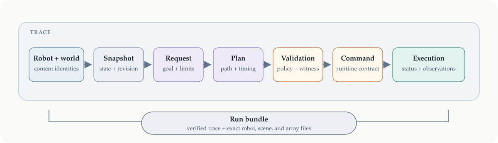

# Traces, run bundles, and replay

An execution log is useful only if its events retain their meaning. ssrobot therefore
records a causal chain rather than an untyped stream of messages: which robot and world
were open, which state a decision used, which command was accepted, how execution
progressed, and what was observed.



*A trace connects decisions to the state and contract under which they were made. A
run bundle makes the referenced files portable and verifiable.*

This document explains how to use that evidence. The exact schemas, invariants, and
refusal codes are specified in [contracts.md](contracts.md#traces) and
[contracts.md](contracts.md#run-bundles).

## Trace a context

`JsonlTrace` is a synchronous sink. Give it to a `RobotContext`; the context writes
records in causal order as it opens, observes, captures snapshots, compiles and submits
commands, receives status, changes its scene, steps, faults, and closes.

```python
import ssrobot

with ssrobot.JsonlTrace("run/trace.jsonl") as trace, ssrobot.RobotContext(
    package.description, runtime, sinks=[trace]
) as ctx:
    snapshot = ctx.snapshot()
    plan = arm.plan_to_configuration(goal, snapshot=snapshot, planner=planner)
    execution = ctx.execute(plan, planner=planner)
    ctx.run_until(execution, max_ticks=5_000)

records = ssrobot.read_trace("run/trace.jsonl")
```

Large arrays, including images, are stored by content hash in an `assets/` directory
beside the JSONL file. Records refer to those arrays rather than repeating them. Reading
is strict: schemas, versions, sequence numbers, clocks, timestamps, payload types,
execution transitions, and references between records are checked before values are
returned. A truncated trace may describe an interrupted run; a contradictory trace is
refused.

A trace records the observations the application requested and the snapshots it
captured. It is not an implicit per-tick state dump. Choose observation and snapshot
cadence according to the evidence or dataset the application needs.

## Preserve portability explicitly

A trace names robot, model, scene, and snapshot identities, but it does not copy all of
their files. `write_bundle` closes that gap after a run:

```python
ssrobot.write_bundle(
    "run/bundle",
    trace="run/trace.jsonl",
    package=package,
    model="mujoco",
    scene="scene.xml",
    scene_root=".",
)

bundle = ssrobot.open_bundle("run/bundle")
```

The bundle contains:

- the trace and only the array assets it references;
- every file used by the selected robot model;
- the scene entry point and its complete include and asset closure;
- a manifest of the robot, model, scene, world, clock, file paths, and content hashes.

Writing is atomic: ssrobot builds and verifies a temporary bundle before placing it at
the destination, and never overwrites an existing destination. Opening verifies every
path, file, hash, and identity before returning anything. It rejects symlinks, escaping
paths, missing or extra files, modified contents, and a trace that names another world.
Verification needs no MuJoCo installation.

A bundle must contain at least one snapshot. The snapshot is what binds the trace to a
particular world; without one, the same event stream could be paired with unrelated
scene files.

## Three meanings of replay

The word *replay* is used for three distinct operations. Keeping them separate avoids
promising more than the evidence contains.

1. **Read the record.** `read_trace` validates and decodes the events. It does not
   simulate or execute anything.
2. **Reconstruct recorded visual state.** The optional mj_viser integration verifies a
   run bundle, rebuilds its MuJoCo world without opening a runtime, applies the recorded
   snapshots, and produces a viewer recording. It shows the snapshots at the cadence
   the application captured; it does not invent intermediate state.
3. **Exercise a runtime contract deterministically.** `ReplayRuntime` executes an
   explicit `ReplayScript`. It is a small runtime used for conformance, application
   tests, and hardware-like external-clock behavior. An arbitrary trace is not silently
   converted into a script.

For MuJoCo-specific state reconstruction, `ssrobot.mujoco.materialize_world` returns a
fresh compiled model plus a mapping that applies a bundle snapshot. It creates no
runtime, controller, or clock and never steps physics. See
[mujoco.md](mujoco.md#planning-scenes) for the world-identity model used by the runtime
and planning scenes.

## Portable and privileged observations

Every channel declares whether it is *privileged*: simulator truth that a physical
robot could not ordinarily supply. Object poses and exact contact channels created by
`MujocoRuntime` are privileged. A robot package may mark its own channels as privileged
as well.

The marking appears in `RuntimeInfo`, which is the trace's first record, and an
observation request can require portable channels only. This lets later tooling
distinguish sensor evidence suitable for deployment from simulator-only supervision.
For example, a planner-generated dataset may use privileged object poses to construct
training labels while retaining only camera and joint channels as policy inputs.

ssrobot records this distinction; dataset conversion and policy training belong to
their integration packages and are planned for M4.

## What the record can and cannot establish

A valid trace establishes that its records are internally consistent and satisfy their
declared schemas. A verified bundle additionally establishes that the trace is paired
with the exact files and content identities named by its snapshots. Neither proves
that an unrecorded physical event did not happen, nor reconstructs data that the
application never observed.

For diagnosis, preserve the trace. For portable inspection or visualization, preserve
a bundle. For learning, choose and record the observation and snapshot cadence before
the run rather than attempting to recover missing state afterward.
